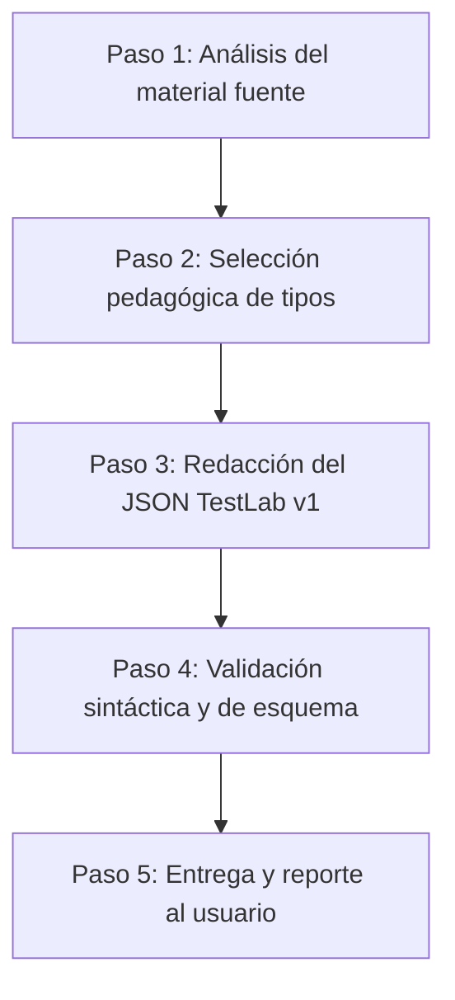

# Generador de Bancos TestLab (v1)

Esta skill guía la transformación rigurosa de material de estudio en bancos de preguntas para la aplicación **TestLab** (formato JSON v1 estricto con validación de esquema).

---

## 1. Reglas fundamentales de integridad

1. **Nunca inventes contenido ausente**: Cada enunciado, respuesta, distractor, cifra, unidad, par o secuencia debe provenir de o fundamentarse estrictamente en el material fuente proporcionado. Si faltan datos clave (tolerancias, unidades o soluciones unívocas), pídelos antes de generar el archivo.
2. **Esquema cerrado (`additionalProperties: false`)**: El validador Ajv de TestLab rechaza cualquier clave no reconocida. **Prohibido terminantemente** añadir `explanation`, `notes`, `rationale`, `difficulty`, `tags`, `points` o metadatos inventados a nivel de pregunta o de banco.
3. **No existe el tipo `IMAGE_BASED`**: Solo existen 8 tipos canónicos. Si una pregunta incluye figura o diagrama, utiliza la propiedad opcional `"image": { "src": "...", "alt": "..." }` dentro de uno de los 8 tipos admitidos.

---

## 2. Flujo de trabajo por fases



### Paso 1: Análisis del material fuente
- Revisa los textos, apuntes o documentos suministrados.
- Identifica conceptos clave, definiciones, procesos cronológicos/secuenciales, fórmulas numéricas y relaciones entre entidades.
- Si el material no tiene soluciones o es ambiguo, pregunta al usuario antes de asumir respuestas.

### Paso 2: Selección pedagógica de tipologías
Distribuye las preguntas de forma equilibrada aprovechando los 8 tipos según la naturaleza del conocimiento:

| Tipo | Cuándo utilizarlo | Clave obligatoria |
| :--- | :--- | :--- |
| `SINGLE` | Conceptos con una única respuesta correcta entre opciones plausibles | `choices` (mín. 2), `answer` (id de opción) |
| `MULTIPLE` | Propiedades, factores o características donde aplican varias opciones | `choices` (mín. 2), `answer` (array de ids) |
| `TRUE_FALSE` | Afirmaciones rotundas, axiomas o reglas claras | `answer` (booleano JSON: `true` o `false`) |
| `FILL_BLANK` | Terminología exacta, fórmulas, nombres técnicos en contexto | Enunciado con `___`, `blanks` (array de variantes) |
| `NUMERIC` | Cálculos, constantes físicas, magnitudes experimentales | `answer`: `{ value, tolerance, unit? }` |
| `MATCHING` | Asociar conceptos con definiciones, autores con obras, causas con efectos | `pairs` (mín. 2 pares `{ left, right }` únicos) |
| `ORDERING` | Pasos de un algoritmo, cronologías, fases de un proceso, jerarquías | `items` (mín. 2 en orden correcto) |
| `SHORT_ANSWER` | Preguntas de desarrollo, justificación o síntesis | `modelAnswer` (texto de referencia para autoevaluación) |

### Paso 3: Redacción del JSON

Estructura raíz obligatoria:
```json
{
  "$schema": "../schema/testlab-bank-v1.schema.json",
  "schemaVersion": 1,
  "title": "Nombre descriptivo del banco",
  "questions": [ ... ]
}
```

### Paso 4: Validación técnica
- Si estás en el repositorio de TestLab, ejecuta la validación o comprueba el archivo con Ajv draft 2020-12 contra `schema/testlab-bank-v1.schema.json`.
- Comprueba que ningún distractor sea idéntico a la respuesta y que los IDs de opciones en `SINGLE`/`MULTIPLE` coincidan exactamente con los declarados en `choices`.

---

## 3. Catálogo de los 8 tipos canónicos (Plantillas Few-Shot)

### 1. `SINGLE` (Opción única)
```json
{
  "id": "q1",
  "type": "SINGLE",
  "prompt": "¿Cuál es la capital administrativa de los Países Bajos?",
  "choices": [
    { "id": "A", "text": "Ámsterdam" },
    { "id": "B", "text": "La Haya" },
    { "id": "C", "text": "Róterdam" }
  ],
  "answer": "B"
}
```

### 2. `MULTIPLE` (Respuesta múltiple)
```json
{
  "id": "q2",
  "type": "MULTIPLE",
  "prompt": "¿Cuáles de los siguientes son lenguajes de programación con tipado estático?",
  "choices": [
    { "id": "A", "text": "Rust" },
    { "id": "B", "text": "Python" },
    { "id": "C", "text": "TypeScript" },
    { "id": "D", "text": "Ruby" }
  ],
  "answer": ["A", "C"]
}
```

### 3. `TRUE_FALSE` (Verdadero / Falso)
> [!IMPORTANT]
> `answer` debe ser un valor booleano nativo (`true` o `false`). No uses strings como `"true"`, `"V"` o `"F"`.
```json
{
  "id": "q3",
  "type": "TRUE_FALSE",
  "prompt": "En JavaScript, los arrays son un subtipo especializado de objeto.",
  "answer": true
}
```

### 4. `FILL_BLANK` (Rellenar huecos)
> [!IMPORTANT]
> Cada hueco en el enunciado debe indicarse con tres o más guiones bajos (`___`). La longitud del array `blanks` debe coincidir exactamente con el número de marcas `___`. Cada elemento de `blanks` es un array con la solución principal y sus sinónimos aceptados.
```json
{
  "id": "q4",
  "type": "FILL_BLANK",
  "prompt": "El proceso mediante el cual las plantas convierten la luz solar en energía química se denomina ___ y se produce principalmente en los ___.",
  "blanks": [
    ["fotosíntesis", "fotosintesis"],
    ["cloroplastos"]
  ]
}
```

### 5. `NUMERIC` (Numérica con tolerancia y unidad)
> [!IMPORTANT]
> `value` y `tolerance` deben ser números finitos, no cadenas de texto. `unit` es opcional (solo si el material la requiere) y se escribe tal cual viene en la fuente sin conversiones no solicitadas.
```json
{
  "id": "q5",
  "type": "NUMERIC",
  "prompt": "Calcula la aceleración debida a la gravedad estándar en la superficie terrestre.",
  "answer": {
    "value": 9.81,
    "tolerance": 0.02,
    "unit": "m/s^2"
  }
}
```

### 6. `MATCHING` (Emparejamiento uno a uno)
> [!IMPORTANT]
> Cada `left` y cada `right` debe ser único tras recortar espacios en blanco.
```json
{
  "id": "q6",
  "type": "MATCHING",
  "prompt": "Empareja cada protocolo de red con su puerto estándar por defecto:",
  "pairs": [
    { "left": "HTTP", "right": "80" },
    { "left": "HTTPS", "right": "443" },
    { "left": "SSH", "right": "22" },
    { "left": "DNS", "right": "53" }
  ]
}
```

### 7. `ORDERING` (Ordenación cronológica o secuencial)
> [!IMPORTANT]
> Los elementos en el array `items` deben escribirse en su **orden secuencial correcto**. La aplicación se encarga de barajarlos al mostrarlos al usuario.
```json
{
  "id": "q7",
  "type": "ORDERING",
  "prompt": "Ordena cronológicamente las siguientes etapas del ciclo de vida de desarrollo de software:",
  "items": [
    "Análisis de requisitos",
    "Diseño de arquitectura",
    "Implementación del código",
    "Pruebas y verificación",
    "Despliegue en producción"
  ]
}
```

### 8. `SHORT_ANSWER` (Respuesta corta / desarrollo guiado)
> [!IMPORTANT]
> Proporciona una `modelAnswer` clara y completa contra la cual el estudiante contrastará su respuesta cualitativa. TestLab no califica automáticamente este tipo por coincidencia exacta de palabras, sino que permite autoevaluación o revisión con IA.
```json
{
  "id": "q8",
  "type": "SHORT_ANSWER",
  "prompt": "Explica la diferencia fundamental entre concurrencia y paralelismo en sistemas operativos.",
  "modelAnswer": "La concurrencia es la capacidad de gestionar y progresar múltiples tareas en periodos de tiempo superpuestos (incluso en un solo núcleo mediante multiplexación en el tiempo), mientras que el paralelismo es la ejecución material simultánea y al mismo instante físico de dos o más tareas en múltiples núcleos o procesadores independientes."
}
```

---

## 4. Imágenes en preguntas

Si una pregunta requiere apoyo visual:
```json
"image": {
  "src": "https://upload.wikimedia.org/wikipedia/commons/.../diagrama.svg",
  "alt": "Esquema funcional del ciclo de Carnot"
}
```
* **Esquemas permitidos**: Únicamente `https://` con nombre de host válido o rutas relativas locales (ej. `examples/figura.svg`, `./figura.svg`).
* **Estrictamente prohibidos**: `http://`, `data:` (imágenes en base64 incrustadas), `blob:`, `file:`, `javascript:` o URLs que comiencen por `//`.

---

## 5. Checklist de auto-verificación antes de entregar

1. [ ] ¿`schemaVersion` es el número entero `1`?
2. [ ] ¿El archivo tiene extensión `.json` y es sintácticamente válido?
3. [ ] ¿Se omitieron todas las claves no admitidas (`explanation`, `difficulty`, `tags`)?
4. [ ] ¿En `TRUE_FALSE`, `answer` es un booleano literal (`true`/`false`)?
5. [ ] ¿En `FILL_BLANK`, el número de `blanks` coincide con el número de marcas `___`?
6. [ ] ¿En `NUMERIC`, `value` y `tolerance` son números (`9.81`) y no strings (`"9.81"`)?
7. [ ] ¿En `MATCHING` y `ORDERING` no existen elementos o pares duplicados?
8. [ ] ¿En `SINGLE` y `MULTIPLE`, los identificadores de `answer` existen exactamente en `choices`?
