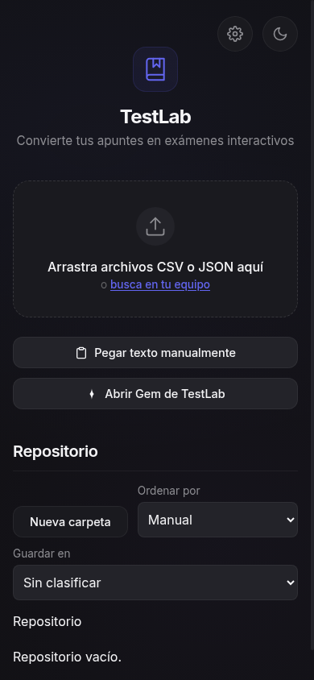
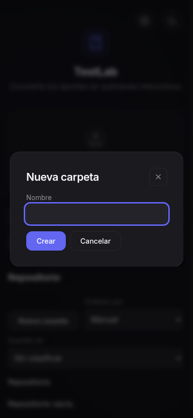
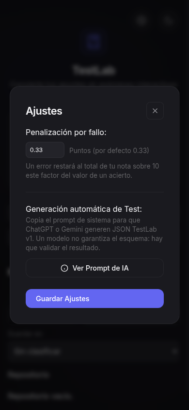
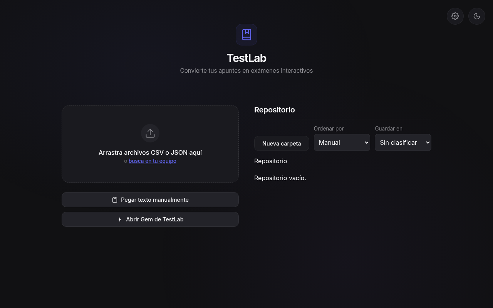

# UI compacta de TestLab

Fecha: 2026-11-06. Vicent aprobó hoy el enfoque «Compacta y directa: menos espacios y más contenido visible en cada pantalla». Este documento cierra ese diseño. No hay plan de implementación en este cambio y no se modifica HTML, CSS, JavaScript, tests, iconos ni el manifiesto.

La base es `main` en `81a30130dc8b1018828a03149af9a4e6a41dd6b7`. El spec de carpetas `docs/superpowers/specs/2026-11-06-library-folders-design.md` sigue vigente para el modelo, el almacén, el orden, los ids y las confirmaciones. Este documento sustituye solo la cáscara visible: la portada, el título «Repositorio», las tarjetas holgadas y la forma de los diálogos y del examen.

## Objetivo

La biblioteca es la pantalla de inicio y la prioridad visual. La importación vive en un diálogo, no en un formulario que ocupe el primer tramo. Cabecera de una línea, filas densas, examen y resultados legibles, tema oscuro por defecto y el botón de tema se queda. En móvil mandan el estudio y un control cómodo con el pulgar. En escritorio la lista usa el ancho disponible y no es una interfaz de teléfono centrada en un campo vacío.

## Decisiones cerradas

- El título visible de la biblioteca es exactamente **Mis tests**. No se usa otro nombre.
- La palabra «Repositorio» no aparece en títulos, migas, vacíos, botones, toasts ni en la opción de destino al mover una carpeta. El prompt de sistema no se reescribe: ahí «repositorio» nombra el proyecto, no la pantalla.
- La portada deja de existir. Se eliminan el icono grande, el subtítulo «Convierte tus apuntes en exámenes interactivos» y la zona de carga permanente.
- Importar es la acción primaria. Nueva carpeta y ordenar la acompañan. «Guardar en» se queda junto a la importación, dentro del diálogo, con la misma persistencia de hoy.
- No hay segunda columna en inicio, modo, examen ni resultados. Una columna ancha no duplica navegación ni acciones.
- El menú de cada fila es un `<details>` en el flujo del documento, hermano del botón que abre la fila. No es un popover y no añade dependencias.
- Los diálogos se abren con `showModal()`. No se usa `command`/`commandfor` ni un polyfill.
- La pantalla activa entra en el flujo del documento. Las inactivas llevan el atributo `hidden` y `display: none`.
- El siguiente `CACHE_NAME`, cuando se implemente, es `testlab-v11`.

## Hallazgos visuales de hoy

Emulación de 390×844, tema oscuro, biblioteca vacía y editor de pegado cerrado. No hubo scroll horizontal. La captura es esa:



Medidas y reglas que explican lo que se ve:

- `.nav-btn` tiene `padding: 10px 20px` y `font-size: 0.9rem`. El alto resultante es de unos **39px**. `.back-btn` mide 36×36 y `.icon-toggle` 44×44. Por debajo del objetivo táctil de 48px.
- La marca, el subtítulo y la zona de arrastre ocupan el primer tramo. La biblioteca queda al final de esa vista, con el título «Repositorio» repetido en el encabezado, en la miga y en «Repositorio vacío.».
- Las etiquetas «Ordenar por» y «Guardar en» usan `--text-secondary` (`#8e8e93`, 5,78:1 sobre `#111113`) a 0,85rem y se leen apagadas. `--text-tertiary` (`#636366`) queda en 3,15:1 y no llega a 4,5:1. El blanco sobre el acento `#6366f1` queda en 4,47:1.
- `body` tiene `overflow: hidden` (`style.css`, regla `body`). `.screen` es `position: fixed; inset: 0; overflow-y: auto`. Una pantalla inactiva sigue en `display: flex` con `opacity: 0`, así que permanece en el árbol de accesibilidad.
- `.history-list` tiene `max-height: 60vh` y su propio scroll. `.upload-layout` llega a 1000px y, por debajo de 800px, a 480px.

Al expandir «Pegar texto manualmente» (se quita `hidden` de `#paste-collapse`, textarea de 120px más el botón) la biblioteca pasa debajo de la vista. El intento de desplazamiento no alcanzó «Nueva carpeta», «Ordenar por», «Guardar en» ni la lista. Esa observación es de la misma emulación 390×844 y no tiene un fotograma propio en este juego de capturas.

El diálogo de carpeta y el de ajustes, en la misma sesión:





En escritorio el bloque queda relativamente estrecho, centrado, con mucho campo vacío alrededor. Las dos columnas no dan más biblioteca; repiten la portada al lado de un repositorio vacío:



### Hipótesis no vinculante

`body { overflow: hidden }`, junto con la pantalla fija y el formulario desplegado, es un candidato a explicar por qué el desplazamiento no llegó a la biblioteca. La implementación **revisa** esa regla. La hipótesis no ordena un parche concreto ni declara que sea la única causa.

### Requisito de alcance

Con el viewport limitado y con cualquier formulario del flujo principal desplegado, todas las acciones de ese flujo se pueden llevar a la vista desplazando. Ningún control del flujo queda fuera de un contenedor que el usuario pueda desplazar. Los viewports de la regresión son 320×568, 390×844, 768×1024, 1280×800 y 1440×900.

La disposición que cumple ese requisito es esta:

- La pantalla activa está en el flujo del documento con `position: relative`. No usa `position: fixed; inset: 0`.
- `html` y `body` no llevan `overflow: hidden` ni `position: fixed`. Con la pantalla en el flujo, conservar `body { overflow: hidden }` volvería a dejar contenido fuera de alcance, así que esa declaración se quita. No se sustituye por otro bloqueo en `html` o `body`.
- El scroll bajo un diálogo modal lo contienen `dialog:modal` y `dialog::backdrop`, como ya pide la guía de diálogo. `dialog::backdrop` añade `overflow: hidden` para ser contenedor de scroll; hoy solo tiene `overscroll-behavior`.
- `#history-list` deja de tener `max-height: 60vh`. La lista crece y desplaza el documento. La barra de herramientas y las migas van en ese mismo scroll, no en un panel aparte que pueda quedar arriba mientras la lista se mueve sola.
- El diálogo de importación, con el textarea lleno de unas 40 líneas, se desplaza dentro del propio diálogo (`max-height: min(90dvh, 40rem); overflow: auto`). «Guardar en», «Añadir texto» y «Cerrar» entran en su caja visible al llevar el scroll del diálogo al final.

## Qué no cambia

- Ocho tipos: `SINGLE`, `MULTIPLE`, `TRUE_FALSE`, `FILL_BLANK`, `NUMERIC`, `MATCHING`, `ORDERING`, `SHORT_ANSWER`. Emparejamientos, respuestas cortas, ordenación y huecos siguen igual.
- La fórmula de `src/score.js`: `Math.max(0, correct - wrong * penalty) / total * 10`, con penalización por defecto `0.33` guardada en `testlab-penalty`. No se editan `src/grade.js` ni `src/score.js`.
- PapaParse 5.4.1, el esquema JSON TestLab v1 y `importBankText`. Un `.txt` con CSV o JSON v1 sigue admitiéndose. Otro sufijo sigue produciendo `${nombre}: formato no admitido`.
- El Gem sigue siendo un recurso externo y opcional. La URL no cambia: `https://gemini.google.com/gem/1kTBWN4ZZ0rlxpnbaalrRotSjX-vYZHcO?usp=sharing`. No hay generación dentro del cliente, ni clave, ni llamada a un modelo.
- KaTeX 0.16.8, `auto-render` y las imágenes con la política actual de `src/image-url.js`.
- Claves `testlab-history`, `testlab-library`, `testlab-library-sort`, `testlab-theme` y `testlab-penalty`. Tema oscuro si falta `testlab-theme`.
- Carpetas sin límite de nivel. Como máximo una carpeta por test. «Sin clasificar» no es una carpeta. No hay papelera, búsqueda, cuentas, sincronización ni deshacer.
- Orden manual, por nombre, por fecha y por nota, con la misma semántica del spec de carpetas. Subir y Bajar siguen desactivados fuera de Manual y en los extremos.
- Borrar pide la confirmación que ya existe. Cancelar no borra.
- `canPreserveTextEntry`, el retorno anticipado `{ preserved: true }` y el hecho de no reemplazar el campo con foco siguen igual en `FILL_BLANK`, `NUMERIC` y `SHORT_ANSWER`. Esa rama no se reescribe.
- En la revisión, la respuesta corta tiene `readOnly` y los botones «La he acertado» y «La he fallado» quedan `disabled`. Un clic sintético no cambia el texto ni el veredicto. El hueco revelado sigue `disabled`. La nota y `#score-detail` al volver de la revisión son los mismos.
- `src/render-history.js` no pinta la pantalla y no se modifica. Sigue en el precache.
- No se añaden dependencias ni un framework. Siguen los `<script>` y las hojas que ya hay.
- Los ids de pantalla se quedan: `upload-screen`, `mode-screen`, `exam-screen`, `loading-screen`, `results-screen`. `upload-screen` es Mis tests.

## Cáscara

Una sola fila, con `padding-top: max(8px, env(safe-area-inset-top))` y alto de controles de 48px.

- Izquierda: el texto **TestLab**, que es la marca. No hay icono de libro de 56px ni subtítulo.
- Derecha: botón de tema y botón de ajustes, 48×48, con `aria-label` «Cambiar tema» y «Ajustes». El tema sigue alternando `data-theme` y `testlab-theme`. Ajustes sigue abriendo el diálogo de penalización y del prompt.
- El `<h1 id="library-title">` de la biblioteca dice **Mis tests**. En la raíz lleva `aria-current="page"`. Dentro de una carpeta se le quita `aria-current`, porque lo lleva la miga actual.
- `document.title` de esa pantalla pasa a `TestLab — Mis tests`. Las otras cadenas de `SCREEN_TITLES` se quedan.

El `<meta name="viewport">` queda en `width=device-width, initial-scale=1, viewport-fit=cover, interactive-widget=resizes-content`.

## Biblioteca

Orden vertical, dentro de una columna de `width: 100%`, `max-width: 960px` y `margin-inline: auto`, con padding de 16px:

1. Título «Mis tests».
2. Barra: botón `#import-btn` con el texto «Importar test» (primario), `#new-folder-btn` «Nueva carpeta», campo «Ordenar por».
3. «Seleccionar todo» solo si el nivel tiene tests. «Borrar seleccionados» solo si hay al menos una casilla marcada. Los dos son botones secundarios de 48px. «Borrar seleccionados» no va relleno de rojo.
4. Migas, solo si hay una carpeta abierta.
5. Filas, o el vacío.

Por debajo de 768px la barra es una rejilla de dos columnas y 8px de separación. «Importar test» y «Nueva carpeta» comparten la primera fila. «Ordenar por» y su `<select id="library-sort">` ocupan la fila siguiente, al 100% del ancho. «Seleccionar todo» y «Borrar seleccionados», cuando existen, comparten una tercera fila de dos columnas; si solo está «Seleccionar todo», ocupa la primera celda. Nada de esa barra desborda en horizontal.

Desde 768px la barra es una fila con `flex-wrap: wrap`, `gap: 8px` y `align-items: center`. Lo que no quepa, también con `font-size` de `document.documentElement` a 32px, baja a la fila siguiente dentro de la columna de 960px. El `scrollWidth` del documento sigue siendo menor o igual que su `clientWidth`.

El `<select id="library-sort">` conserva las opciones y los valores `manual`, `name`, `imported` y `score`, con las etiquetas «Manual», «Nombre (A–Z)», «Fecha de importación» y «Última nota».

### Migas

Sigue siendo `<nav aria-label="Ruta de la biblioteca">` y una `<ol class="library-breadcrumbs">`. Los ancestros son botones. La carpeta actual es un `<span aria-current="page">`.

El nombre de la raíz, en los dos sitios de `src/library.js` (`view` cuando el índice está bloqueado, y `breadcrumbTrail`), pasa de `'Repositorio'` a `'Mis tests'`. No se escribe en `localStorage`. Es solo la cadena que pinta la miga y el destino de mover una carpeta.

En la raíz (`breadcrumbs.length === 1`) `renderLibrary` no pinta la navegación. El título de la página ya es esa ubicación. Desde el primer nivel anidado, la primera miga es el botón «Mis tests» y vuelve a la raíz.

La lista de migas tiene `min-width: 0`, `max-width: 100%` y `overflow-x: auto`. No ensancha el documento. Al pintar, la miga actual se lleva a la vista con `scrollIntoView({ inline: 'nearest', block: 'nearest' })`. Cada nombre de ancestro puede ocupar hasta dos líneas y luego se trunca; el desplazamiento de la propia nav cubre una ruta larga.

### Vacío

Raíz, sin carpetas y sin tests. `renderLibrary` pinta, dentro de `#history-list`, un bloque y nada más:

```html
<div class="library-empty">
  <p>Todavía no hay tests. Un CSV o un JSON TestLab v1 válido se guarda solo en este navegador.</p>
  <button type="button" id="empty-import" class="nav-btn primary">Importar test</button>
  <button type="button" id="empty-folder" class="nav-btn">Crear carpeta</button>
</div>
```

`renderHistory` vuelve a enlazar esos botones después de cada pintado: `#empty-import` abre el diálogo de importación y `#empty-folder` ejecuta el mismo manejador que `#new-folder-btn`. No hay un segundo formulario. La barra de arriba sigue mostrando los suyos.

Carpeta vacía: el mismo bloque, con el párrafo exactamente «Esta carpeta está vacía.» y los mismos ids. Crear carpeta sigue creando dentro del nivel actual. Importar no cambia el destino: es el valor que ya tenga «Guardar en».

Con contenido, el párrafo de vacío no se muestra. La barra sí.

## Importación

`<dialog id="import-dialog" class="modal" aria-labelledby="import-dialog-title">`, abierto con `showModal()` desde «Importar test». Sin `role="dialog"` y sin `aria-modal`. El foco inicial es el botón «Elegir archivos» (`autofocus`). Al cerrar, el navegador devuelve el foco al botón que abrió. No se escribe un retorno de foco a mano.

Título: **Importar test**. Botón de cierre con `aria-label` «Cerrar», `type="button"`, que llama a `close()` sin valor de confirmación. Escape cierra igual y no importa. No se pone `closedby="any"`: pulsar fuera no importa ni descarta un texto a medio pegar. No hace falta el atributo `closedby`; el modal ya se cierra con Escape.

Contenido, en este orden:

1. Archivo. `<input id="file-input" type="file" accept=".csv,.json,.txt,text/csv,application/json,text/plain" multiple>`. El botón visible «Elegir archivos» abre ese input. Texto de ayuda: «Uno o más archivos .csv o .json. También vale un .txt con ese mismo contenido.»
2. Soltar archivos, solo como añadido. La zona de suelta está dentro del diálogo y escucha `dragenter`, `dragover`, `dragleave` y `drop` como hoy. En un dispositivo sin arrastre, «Elegir archivos» basta. Soltar sobre la página, con el diálogo cerrado, no importa.
3. Pegar. `<label for="paste-input">Pegar CSV o JSON v1</label>` y el textarea `#paste-input`. El botón `#load-paste-btn` dice **Añadir texto**, es primario y sigue `disabled` mientras el recorte del textarea está vacío. El placeholder es `CSV: Pregunta;SINGLE;Opción A;Opción B;A` y, en la línea siguiente, `JSON v1: { "schemaVersion": 1, "questions": [ ... ] }`.
4. Destino. `<label for="import-folder">Guardar en</label>` y `<select id="import-folder">`. La primera opción es «Sin clasificar» con `value=""`. Las demás son las rutas de `listFolders()`, con `textContent`. `fillSelect` sigue conservando `select.value` si esa opción existe y, si no, vuelve a `""`. Abrir el diálogo no cambia esa selección. El primer valor, con el control recién creado, es Sin clasificar. `rememberBank` sigue pasando `ui.importFolder.value || null`.
5. Enlace. `<a href="https://gemini.google.com/gem/1kTBWN4ZZ0rlxpnbaalrRotSjX-vYZHcO?usp=sharing" target="_blank" rel="noopener noreferrer">Abrir Gem de TestLab</a>`. Al lado, el texto: «El Gem es un recurso externo y opcional. TestLab no genera las preguntas.» El mismo enlace sigue dentro del diálogo del prompt. No se muestra en la biblioteca.

Los errores siguen en `#import-errors` con `role="alert"`, dentro del diálogo. Se conservan los mensajes que ya produce la importación: errores de PapaParse con el nombre del archivo, `path` y `message` del validador, «La carpeta de destino ya no existe», «No se pudo guardar el banco», «formato no admitido» y «no se pudo leer». El toast de éxito pasa de «Añadido al repositorio» a **«Añadido a Mis tests»**. «Banco guardado con avisos» se queda. Si no se guarda nada, el toast sigue siendo la primera nota o «No se encontraron preguntas válidas».

El botón de pegar y el de archivo son `type="button"`. Enter en el textarea no cierra el diálogo ni envía un `<form method="dialog">`.

Varios archivos siguen compartiendo el destino elegido y el mismo recuento de guardados.

## Filas

Cada carpeta y cada test es una fila, no una tarjeta con el padding de 16px y una pila de botones. Contenedor `<article class="library-row">`, padding `8px 12px`, separación entre filas de 8px, borde de 1px `--border`, fondo `--bg-raised`, radio de 8px. Alto mínimo 48px.

El nombre visible usa `line-clamp: 2`, `overflow: hidden` y `overflow-wrap: anywhere`. Un nombre de 200 caracteres no ensancha la página. El nombre completo forma parte del nombre accesible del botón de abrir y del de acciones.

Los iconos decorativos llevan `aria-hidden="true"`. Un badge que informe es texto: «3 tests», «2 preguntas • fecha», «Nota: 8/10» o «Sin realizar». No hay un badge que sea solo un color.

Estructura de una carpeta, sin casilla y sin un botón dentro de otro botón:

```html
<article class="library-row">
  <button type="button" class="library-row-open" data-action="open-folder">…nombre…</button>
  <details class="library-menu">
    <summary>Acciones</summary>
    …botones…
  </details>
</article>
```

El botón de abrir tiene `aria-label` `Abrir ${nombre}` y `data-action="open-folder"`. El `<summary>` tiene `aria-label` `Acciones de ${nombre}`, alto y ancho mínimos de 48px. Pulsar la fila abre la carpeta. Pulsar «Acciones» solo abre o cierra el `<details>`. Al abrir uno, se cierran los otros `<details>` de `#history-list`.

Dentro del menú, botones de 48px y 16px, en flujo, a todo el ancho del panel:

- `Renombrar carpeta ${nombre}`
- `Mover carpeta ${nombre}`
- `Subir carpeta ${nombre}`
- `Bajar carpeta ${nombre}`
- `Borrar carpeta ${nombre}`

Subir y Bajar respetan `movementDisabled` como ahora.

Estructura de un test: la casilla es hermana, envuelta en un `<label>` de al menos 48×48. El input conserva `aria-label` `Seleccionar ${nombre}` y `data-id`. El botón de abrir tiene `aria-label` `Empezar ${nombre}` y `data-action="start"`. El menú no incluye borrar. Sus botones son `Renombrar ${nombre}`, `Mover ${nombre}`, `Subir ${nombre}` y `Bajar ${nombre}`, con los `aria-label` que ya usan esas acciones. El borrado de tests sigue siendo la selección más «Borrar seleccionados».

En la raíz, si hay tests, el `<h3 class="library-group">` «Sin clasificar» se mantiene delante de esos tests. Las subcarpetas siguen pintándose antes que los tests del nivel.

La confirmación de carpeta no cambia: `Se eliminarán ${n} carpeta(s) y ${n} test(s). Esta acción no se puede deshacer.`, con `countLabel`. La de tests seleccionados pasa a: `¿Seguro que deseas borrar ${countLabel(n, 'test', 'tests')}? Esta acción no se puede deshacer.` Cancelar sigue el primero, con `autofocus`. Borrar no es el botón primario.

Al mover una carpeta, la opción de la raíz del `<select>` deja de decir «Repositorio» y dice **Mis tests**. El valor vacío sigue significando la raíz. Al mover un test, la opción vacía sigue diciendo «Sin clasificar».

Renombrar un test sigue usando `window.prompt` con el texto «Introduce un nuevo nombre para este banco de preguntas:». El spec de carpetas fijó ese contrato y esta entrega no lo pasa al diálogo de carpeta. Un nombre vacío o solo espacios sigue sin guardarse.

## Modo

Misma secuencia: abrir un test muestra el modo; Estudio o Examen llaman a `startExam` en el acto. No hay un paso extra de confirmar.

Título visible: «¿Cómo quieres estudiar?». `#question-count-label` sigue con el texto que ya escribe `loadFromHistory` (`N preguntas pre-cargadas`).

El botón de vuelta tiene el texto visible **Volver** y `aria-label` «Volver a Mis tests». Sigue usando `#back-to-upload` y `showScreen('upload')`.

Dos botones, no radios, porque la elección navega al momento:

- `#mode-study`, nombre accesible «Modo Estudio». Descripción visible: «Feedback inmediato tras cada respuesta.»
- `#mode-exam`, nombre accesible «Modo Examen». Descripción visible: «Responde todo y revisa al final.»

Por debajo de 768px van en columna, con padding `12px 16px` y alto mínimo 48px. Desde 768px van en una rejilla de dos columnas iguales, dentro de una columna de `max-width: 720px`. No hay flecha ni desplazamiento lateral al pasar el puntero.

## Examen

La columna del examen mide como máximo 640px, centrada. Ese ancho es de lectura, no una segunda navegación.

Barra superior, una fila:

- Botón `#quit-btn` con texto visible **Salir**. Sigue llamando a `resetApp`.
- `#question-counter` con el texto `${índice + 1} / ${total}`.
- `<progress id="exam-progress" aria-label="Progreso del examen">`. `max` es `questions.length`. `value` es el número de respuestas que `countsAsAnswered` cuenta, el mismo criterio que hoy usa el ancho de `.progress-fill`. No representa el índice. No hay texto dentro de `<progress>`. No recibe foco. `#progress-fill` y `.progress-track` se eliminan.

La barra se estiliza con `appearance: none`, `border: 0 solid` y `overflow: clip`. El avance WebKit va en `::-webkit-progress-value` y el de Firefox en `::-moz-progress-bar`, en reglas separadas. El relleno es `--accent-bar` y el carril `--bg-element`. Alto 8px. El contraste de ese par está en los tokens.

La pregunta y las opciones usan como mínimo 16px; el enunciado, 18px; la altura de línea, 1,4. En `SINGLE` y `MULTIPLE`, `.options-list` lleva `role="group"` y `aria-labelledby` del id del enunciado. Esas opciones ya exponen `aria-pressed`. `MULTIPLE` ya muestra «✓» en `.checkbox-icon` cuando está pulsada; `SINGLE` pasa a mostrar el mismo «✓» visible en ese caso. Si está pulsada, las dos añaden un `<span class="visually-hidden">Seleccionada</span>`. El manejador del clic y la forma de la respuesta no cambian. `TRUE_FALSE` sigue siendo un `<fieldset>` con radios «Verdadero» y «Falso»: el radio marcado es la señal que no depende del color, y no se convierte en un botón pintado. El borde de acento es adicional. El estado correcto o incorrecto sigue teniendo frase en `.answer-status`, copiada a `#question-status` (`aria-live="polite"`). El color de `.answer-status` es `--text-primary`.

La zona de la pregunta es el único scroll interno del examen: `flex: 1; min-height: 0; overflow-y: auto; scroll-padding-bottom: 64px`. La barra inferior es `position: sticky; bottom: 0`, con fondo `--bg`, `padding-top: 8px` y `padding-bottom: max(8px, env(safe-area-inset-bottom))`. El teclado, al encoger el viewport, deja la barra en la vista y el campo o el aviso se desplazan por encima de ella. El aviso `.answer-status` vive en la zona de la pregunta, no debajo de la barra.

Botones de la barra, en este orden, con la misma lógica de `updateNavButtons` (cuáles se muestran no cambia): Anterior, Saltar, Duda IA, Comprobar, Siguiente, Finalizar. En la última pregunta de la revisión, Finalizar sigue mostrando «Volver a resultados».

Comprobar, Siguiente y Finalizar son el botón primario, uno cada vez. Anterior, Saltar y Duda IA son secundarios. En la barra:

```css
.exam-bottombar { display: flex; flex-wrap: wrap; gap: 8px; }
.exam-bottombar .nav-btn {
  min-height: 48px;
  font-size: 16px;
  flex: 1 1 calc(50% - 8px);
  white-space: nowrap;
}
.exam-bottombar .nav-btn.primary { flex-basis: 100%; }
```

A 320px y a 390px, con el padding de 16px, esa cuenta cabe en el ancho y la barra no tiene scroll horizontal. `overflow-x` de la barra no se usa para esconder un desborde: la prueba exige `scrollWidth <= clientWidth`.

## Resultados

Columna de `max-width: 480px`. El anillo conserva el `viewBox` 120, el radio 52 y el cálculo `2 * Math.PI * 52`. Solo cambia la caja CSS, de 140px a 96px. El número sigue siendo `scoreLabel` (nota sobre 10), no un porcentaje. El trazo sigue siendo `var(--incorrect)` si `scoreOutOf10 < 5` y `var(--accent)` en otro caso. No se pinta de verde.

Los mensajes de `#score-message` y el detalle de `#score-detail` no cambian, incluidos los recuentos y `(Penaliza: -${penaltyFactor})`. La pausa de 1500ms en la pantalla de carga se queda.

Acciones, en columna, al 100% y a 48px:

1. «Descargar Reporte IA», mismo `generateFinalReport` y el mismo archivo `Reporte_TestLab_IA.txt`.
2. «Ver detalles», misma revisión.
3. `#restart-btn` pasa a decir **Volver a Mis tests** y sigue llamando a `resetApp`.

## Diálogos

Ajustes, prompt, carpeta, mover y borrado usan `<dialog>` abierto con `showModal()`. Ninguno lleva `role="dialog"` ni `aria-modal`. No hay trampa de foco escrita a mano. Escape cierra. El cierre con la X es un `<button type="button" aria-label="Cerrar">` que llama a `close()`.

| Diálogo | Nombre accesible | Foco inicial |
| --- | --- | --- |
| `#import-dialog` | título «Importar test» | «Elegir archivos» |
| `#settings-modal` | `aria-labelledby` del `<h2>` «Ajustes» | `#penalty-input` |
| `#ai-prompt-modal` | `aria-labelledby` del `<h2>` «Prompt para IA» | «Copiar Prompt» |
| `#library-dialog` | `#library-dialog-title` | el nombre, o el destino si el nombre está oculto |
| `#delete-dialog` | `#delete-dialog-title` | `#delete-cancel` |

Ajustes conserva la penalización, el texto de que un modelo no garantiza el esquema, «Ver Prompt de IA» y «Guardar Ajustes». El prompt conserva el texto de `SYSTEM_PROMPT_JSON_V1`, «Copiar Prompt» y el enlace al Gem. Crear, renombrar y mover conservan sus títulos, «Nombre», «Destino», el error `#library-dialog-error` con `role="alert"` y el formulario `method="dialog"`.

No se asigna `display` a `dialog` fuera de `dialog[open]`. El centrado manual con `transform: translate(-50%, -50%)` se quita; el diálogo modal lo coloca el navegador. La ficha interior tiene padding de 16px, `max-width: min(32rem, calc(100vw - 32px))` y el diálogo `max-height: min(90dvh, 40rem)` con `overflow: auto`.

```css
dialog:modal { overscroll-behavior: contain; }
dialog::backdrop {
  background: rgba(0, 0, 0, 0.6);
  overflow: hidden;
  overscroll-behavior: contain;
}
```

Se conserva `backdrop-filter: blur(4px)` en `dialog::backdrop`. No es el mecanismo que bloquea el scroll.

## Tokens

Escala de espacio del cascarón, de las filas, de las barras y de los diálogos: **8px, 12px y 16px**. El alto táctil de 48px es el mínimo del control, no un hueco. El contorno de foco es de 3px con 2px de separación. Los bordes son de 1px.

Controles (botones, inputs, selects, textarea, `summary`): `font-size: 16px` y `min-height: 48px`. La meta de una fila va a 14px en `--text-secondary`. El enunciado de la pregunta va a 18px.

Tema oscuro por defecto:

| Token | Valor | Uso |
| --- | --- | --- |
| `--bg` | `#111113` | página |
| `--bg-raised` | `#1c1c21` | filas y fichas |
| `--bg-element` | `#2a2a31` | campos y carril |
| `--bg-element-hover` | `#34343d` | hover |
| `--border` | `rgba(255, 255, 255, 0.12)` | separación de superficies |
| `--border-hover` | `rgba(255, 255, 255, 0.22)` | hover |
| `--text-primary` | `#f5f5f7` | texto principal, 17,3:1 sobre `--bg` |
| `--text-secondary` | `#c8c8cd` | etiquetas, 11,3:1 sobre `--bg` y 10,2:1 sobre `--bg-raised` |
| `--text-tertiary` | `#a1a1aa` | meta no esencial, 7,4:1 sobre `--bg` |
| `--accent` | `#1d4ed8` | botón primario |
| `--accent-hover` | `#1e40af` | hover del primario |
| `--accent-text` | `#ffffff` | texto sobre el primario, 6,7:1 sobre `#1d4ed8` |
| `--accent-bar` | `#93c5fd` | relleno de `<progress>` en oscuro, 7,9:1 sobre `#2a2a31` |
| `--focus` | `#93c5fd` | anillo `:focus-visible` |
| `--correct` | `#34d399` | acierto, solo feedback |
| `--incorrect` | `#f87171` | fallo y texto de error, solo feedback |

Tema claro: se conservan `--bg #f8fafc`, `--bg-raised #ffffff`, `--text-primary #0f172a` y `--text-secondary #475569`. `--text-tertiary` pasa a `#64748b` (4,6:1 sobre `#f8fafc`). `--accent` y `--accent-hover` son los mismos azules. `--accent-bar` y `--focus` en claro son `#1d4ed8` (6,4:1 sobre `#f8fafc`). `color-scheme` sigue atado a `data-theme`.

El anillo `:focus-visible` de enlaces, botones, inputs, selects, textarea y `summary` es `outline: 3px solid var(--focus); outline-offset: 2px`. No se deja `outline: none` en `#paste-input` ni en otro control sin ese reemplazo.

Verde y rojo no rellenan botones de la biblioteca, de la barra del examen ni de la navegación. El botón de confirmar un borrado sigue siendo secundario, no rojo. El rojo del anillo de resultados por debajo de 5 y los fondos de acierto y fallo de una opción son feedback de la respuesta.

A 1280 y a 1440 la biblioteca usa la columna de 960px. El resto del viewport es margen. No hay rejilla de dos columnas de filas: carpetas y tests son una sola secuencia.

## Pantallas inactivas

Hoy una pantalla sin `.active` sigue expuesta porque `.screen { display: flex }` gana al `[hidden]` del agente de usuario, y ni siquiera lleva el atributo. La corrección es de DOM y de CSS a la vez.

En el HTML, `mode-screen`, `exam-screen`, `loading-screen` y `results-screen` nacen con el atributo `hidden`. `upload-screen` no.

```css
.screen:not([hidden]) { display: flex; }
.screen[hidden] { display: none !important; }
```

Ninguna regla `.screen { display: grid }` ni `.screen { display: flex }` puede aplicarse a un elemento con `hidden`. Si una pantalla activa necesita rejilla, la rejilla va en un hijo, o en `.screen:not([hidden])`, nunca en `.screen` a secas.

```js
function showScreen(name) {
  Object.entries(screens).forEach(([key, screen]) => {
    const active = key === name;
    screen.classList.toggle('active', active);
    screen.toggleAttribute('hidden', !active);
  });
  document.title = SCREEN_TITLES[name];
}
```

`opacity: 0` y `pointer-events: none` no sustituyen a `hidden`. El estilo calculado de una pantalla inactiva es `display: none`.

## Iconos y caché

Esto se hace en la implementación posterior, no en el commit de este spec. Hoy `index.html` y `manifest.json` apuntan a `icon.png`, y ese archivo no está en el repositorio. No hay favicon SVG, ni icono de 192, ni `purpose: "maskable"`. `CACHE_NAME` es `testlab-v10` y el precache no lista iconos.

Archivos nuevos:

- `favicon.svg` en la raíz. SVG válido, con `viewBox`, sin `<script>` y sin referencias externas. Es el icono de pestaña.
- `icons/icon-192.png`, 192×192, `purpose` `any`.
- `icons/icon-512.png`, 512×512, `purpose` `any`.
- `icons/icon-maskable-192.png`, 192×192, `purpose` `maskable`, dibujo dentro del 80% central.
- `icons/icon-maskable-512.png`, 512×512, `purpose` `maskable`, la misma zona segura.

`manifest.json` lista esos cuatro PNG con `src`, `sizes`, `type: "image/png"` y `purpose`. Se quita la entrada de `icon.png`. `name` pasa a «TestLab» y `short_name` se queda en «TestLab». `background_color` es `#111113`. `theme_color` del manifiesto y `<meta name="theme-color">` son `#1d4ed8`.

En `index.html`, `<link rel="icon" href="favicon.svg" type="image/svg+xml">` sustituye al PNG ausente.

En `sw.js`, `CACHE_NAME` pasa a `testlab-v11`. `ASSETS` suma `./favicon.svg`, `./manifest.json` y los cuatro PNG. No se añade este Markdown ni `prompts/`. `test/sw-precache.test.js` pasa a esperar `testlab-v11` y sigue exigiendo que cada ruta del precache exista.

## Pruebas

La implementación posterior las añade o las actualiza. Este commit no las ejecuta ni las modifica. Tienen que poder fallar por un motivo concreto.

Unidad:

- Las dos migas de raíz de `createLibrary` se llaman «Mis tests», también con el índice bloqueado.
- `renderLibrary` en la raíz no crea `<nav>`. El vacío contiene ese párrafo completo, `#empty-import` con el texto «Importar test» y `#empty-folder` con el texto «Crear carpeta».
- Una carpeta vacía dice «Esta carpeta está vacía.»
- Una carpeta pinta un botón «Abrir ${nombre}» y un `summary` «Acciones de ${nombre}». Esos dos no están anidados. El menú contiene renombrar, mover, subir, bajar y borrar, con subir y bajar `disabled` cuando el orden no es manual o están en el extremo.
- Un test pinta la casilla «Seleccionar ${nombre}» fuera del botón «Empezar ${nombre}». Su menú no contiene borrar.
- Un nombre con `` sigue saliendo como texto, sin elemento `img` creado por el nombre.
- `index.html` contiene `hidden` en las cuatro pantallas que no son la biblioteca, la regla `.screen[hidden]` y no contiene el subtítulo «Convierte tus apuntes en exámenes interactivos» ni el botón «Añadir al Repositorio».
- El enlace del Gem en el HTML es exactamente la URL de arriba.

Extremo a extremo, Playwright, sin scroll horizontal (`document.documentElement.scrollWidth <= document.documentElement.clientWidth`) en 320, 390, 768, 1280 y 1440, en biblioteca, modo, examen de una pregunta y resultados:

- A 390×844 la biblioteca vacía muestra «Mis tests», `#import-btn` y `#empty-import` con el texto «Importar test», y `#empty-folder` con «Crear carpeta», sin abrir un formulario antes. Abrir el diálogo en ese estado usa `#empty-import`. Con filas ya pintadas, lo abre `#import-btn`.
- Abrir importar, escribir unas 40 líneas en `#paste-input` y llevar `scrollTop` del diálogo a `scrollHeight` deja «Guardar en» y «Añadir texto» intersecando la caja del diálogo.
- Importar `examples/banco-mixto.csv` y `examples/banco-mixto.json`, elegir una carpeta en «Guardar en» y ver cada banco en esa carpeta. El destino elegido se mantiene al volver a abrir el diálogo. Un destino borrado mientras el diálogo estaba abierto produce «La carpeta de destino ya no existe» y no escribe.
- Crear carpeta, abrirla, recorrer la miga «Mis tests», ordenar, renombrar, mover una carpeta a «Mis tests», mover un test a «Sin clasificar» y borrar. Cancelar el borrado deja el elemento. Confirmar lo elimina con el recuento de carpetas y tests.
- Un nombre de 200 caracteres a 320px no provoca scroll horizontal y se ve recortado a dos líneas.
- Con 30 tests, el `summary` de acciones del último entra en el viewport al desplazar el documento.
- `body` y `html` no tienen `overflow: hidden` en el estilo calculado.
- Con la biblioteca activa, las otras cuatro pantallas tienen el atributo `hidden` y `display` calculado `none`, y un localizador que ignora lo oculto no las encuentra.
- Abrir ajustes deja el foco dentro del diálogo. Escape lo devuelve a `#settings-btn`.
- Tab hasta «Importar test» muestra un contorno que no es `none`.
- En un examen, `progress` tiene `max` igual al número de preguntas, un valor igual a las respondidas y el nombre accesible «Progreso del examen».
- A 320px la barra inferior del examen, con Anterior, Saltar, Duda IA y el primario que toque, cumple `scrollWidth <= clientWidth`.
- Las pruebas ya escritas de foco y caret (`test/text-entry.test.js`, `e2e/text-entry.spec.js`) siguen pasando sin relajar aserciones. La de revisión sigue viendo `readOnly`, los dos veredictos `disabled`, el texto intacto tras teclear «MUTACION» y la misma nota al volver.
- `npm test` y las e2e de biblioteca, humo y texto cubren el recorrido. Donde una e2e pega texto y pulsa «Añadir al Repositorio», pasa a abrir el diálogo con `#import-btn` o `#empty-import`, rellenar `#paste-input` y pulsar «Añadir texto». Donde pulsa la miga «Repositorio», pulsa «Mis tests». Donde elige el destino de mover «Repositorio», elige «Mis tests».
- Con `document.documentElement.style.fontSize = '32px'` y viewport de 1280px, la biblioteca no tiene scroll horizontal.
- Las peticiones a `favicon.svg`, los cuatro PNG y `manifest.json` responden 200. El manifiesto no menciona `icon.png`.

La compacidad se considera lograda cuando, a 390×844 con un test ya importado, la primera fila se ve sin atravesar una portada, los controles de la barra miden al menos 48px y queda sitio para el nombre. No se aprietan por debajo de 16px ni de 8px de separación.

## Archivos de la implementación posterior

Cuando Vicent apruebe este spec, el plan —que este cambio no escribe— puede tocar:

- `index.html`, `style.css`, `app.js`
- `src/library.js` (solo las dos cadenas de la raíz)
- `src/render-library.js`
- `src/render-question.js`, solo para el «✓» de `SINGLE`, el texto «Seleccionada» y `role="group"` en la lista de opciones. No se modifica `canPreserveTextEntry`, el retorno `{ preserved: true }`, el `readOnly` de la respuesta corta ni el `disabled` de «La he acertado» y «La he fallado».
- `manifest.json`, `sw.js`
- `favicon.svg` e `icons/icon-192.png`, `icons/icon-512.png`, `icons/icon-maskable-192.png`, `icons/icon-maskable-512.png`
- las pruebas y e2e que afirman el copy viejo
- el párrafo de biblioteca del `README.md`, para decir que la pantalla se llama «Mis tests», sin borrar las limitaciones ya escritas

No entran `src/grade.js`, `src/score.js`, `src/csv-bank.js`, `src/json-bank.js`, `src/validate-bank.js`, `src/ai-prompt.js`, `prompts/system-prompt-json-v1.md` ni `src/render-history.js`.

## Fuera de este cambio

No se implementa el rediseño, no se fusiona y no se despliega. No hay plan en `docs/superpowers/plans/`. El siguiente paso, después de que Vicent revise este archivo, es escribir ese plan.
